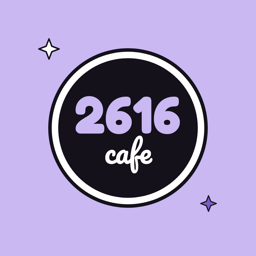
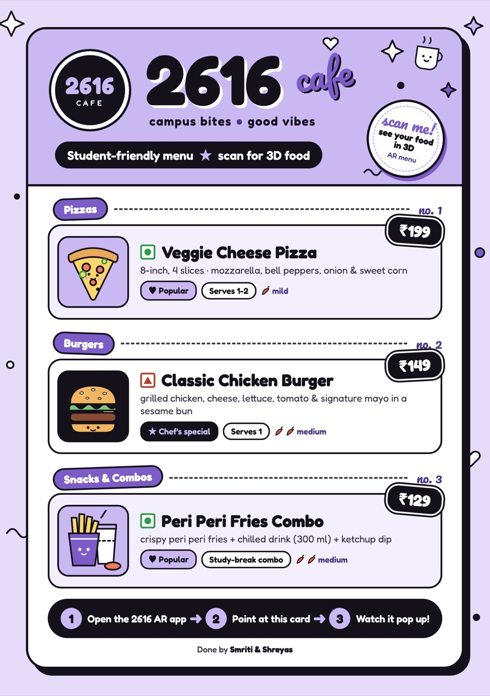
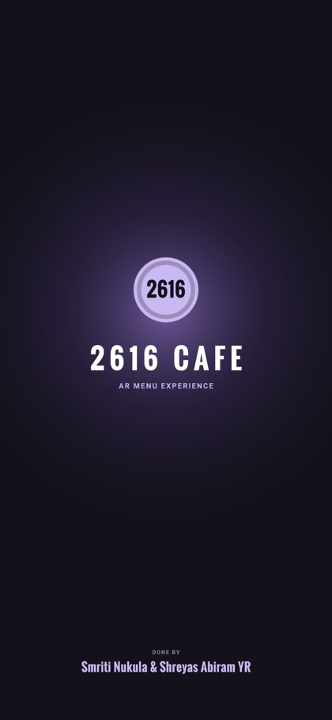
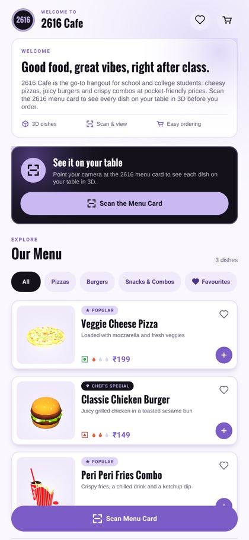
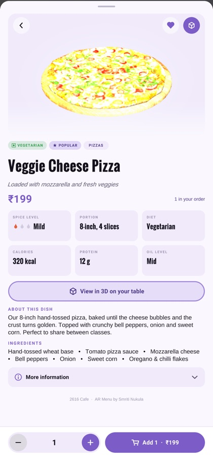
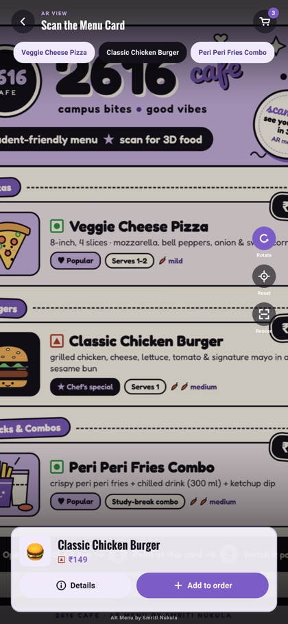
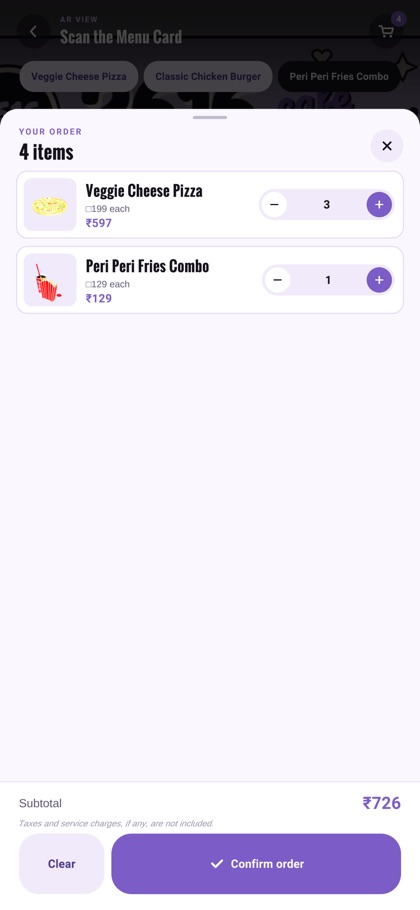
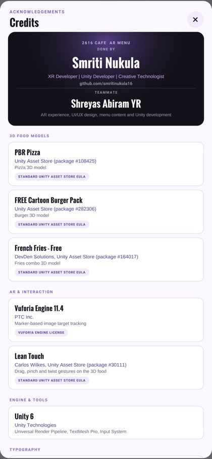

<div align="center">



# 2616 Cafe — AR Menu

**Scan the menu card. See your food on the table in 3D. Order in a tap.**

A marker-based augmented-reality food menu built with **Unity 6** and **Vuforia Engine**,
designed for student cafes and restaurants.


</div>

---

## 📋 The menu card (AR image target)

The printed menu card is also the AR marker. Print it, open the app and point the camera at it.

<div align="center">
<a href="MenuCard/2616_Cafe_Menu_Card_A5.pdf"></a>

**[⬇️ Download the printable menu card (PDF, A5)](MenuCard/2616_Cafe_Menu_Card_A5.pdf)**
</div>

> **Printing tips:** print at **100 % / actual size** on **A5 (148 × 210 mm)** matte paper. Don't use "fit to page",
> because the app expects the card to be 148 mm wide. Keep it flat and well lit.

---

## 📱 Screenshots

| Splash | Menu | Dish details |
|:---:|:---:|:---:|
|  |  |  |
| **AR view** | **Your order** | **Credits** |
|  |  |  |

---

## ✨ Features

**Augmented reality**
- 📷 Marker-based tracking of the printed 2616 menu card (Vuforia image target).
- 🍕 Realistic 3D pizza, burger and fries combo placed on the card.
- 🤏 Drag to move, pinch to scale and twist to rotate (Lean Touch). Auto-rotate, reset and rescan controls are included.
- 🔁 Switch dishes live in AR, with guidance for "searching", "found" and "lost" tracking states.

**Menu and ordering**
- 🗂️ Category chips (Pizzas, Burgers, Snacks & Combos) and a **Favourites** filter.
- 📝 Rich dish sheet with description, ingredients, preparation, taste profile, portion size and spice level. It also shows veg or non-veg diet and verified allergens.
- 🛒 Working order flow: add to order, quantity stepper, running total and order confirmation. The cart and favourites are saved between sessions.
- 🖼️ Dish thumbnails are rendered live from the 3D models, so you don't need any extra images.

**Design**
- 💜 A premium lavender, white and black theme, with custom fonts and smooth animations.
- 📐 Responsive portrait layout with safe-area support for notched phones, plus the Android back button.
- 🏷️ Branded splash screen, app icon and a dedicated **Credits** panel.
- 🧾 All menu content comes from one JSON file, so it's easy to re-brand for any cafe.

---

## 🚀 Getting started

### Requirements
| | |
|---|---|
| Unity | **6000.3.8f1** (Unity 6) with the **Android Build Support** module |
| AR SDK | **Vuforia Engine 11.4.4** (free developer account) |
| Device | Android phone with a camera, **Android 13 (API 33)** or newer |

### 1. Clone the repository
```bash
git clone https://github.com/smritinukula16/food-menu-information-ar.git
cd food-menu-information-ar
```

### 2. Add the Vuforia Engine package
The Vuforia package (~130 MB) is too large for GitHub, so it is not included.
1. Sign in at [developer.vuforia.com](https://developer.vuforia.com/downloads/sdk) and download **Vuforia Engine 11.4.4 for Unity**.
2. Put the file `com.ptc.vuforia.engine-11.4.4.tgz` in the project's **`Packages/`** folder.
   `Packages/manifest.json` already references it.

### 3. Open the project
1. In **Unity Hub**, choose **Add → Add project from disk** and select the folder. Open it with **6000.3.8f1**.
2. Open the scene **`Assets/Scenes/SampleScene.unity`**.

### 4. Add your Vuforia licence key
1. Create a free **Basic** licence key in the [Vuforia License Manager](https://developer.vuforia.com/develop/licenses).
2. In Unity, select **ARCamera**, click **Open Vuforia Engine configuration**, and paste the key into **App License Key**.

> Always use **your own** key. The project's key is tied to its owner's Vuforia account.

### 5. Try it in the Editor
1. Press **Play**. The splash screen appears, followed by the menu.
2. Tap **Scan the Menu Card** and show the printed card (or the PDF on another screen) to your webcam.
3. No webcam? Use the Editor shortcuts: press **F** to simulate *marker found* and **G** for *marker lost*.

### 6. Build for Android
1. Open **File → Build Profiles** and switch the platform to **Android**.
2. Connect your phone with USB debugging enabled, then click **Build And Run**.
3. Print the menu card, open **2616 Cafe AR Menu** and scan it.

---

## 🛠️ Editor tools

Find these under **Tools → AR Menu** in the Unity menu bar.

| Menu item | What it does |
|---|---|
| **Install Into Open Scene** | Adds or repairs the AR Menu app object in the open scene. |
| **Use 2616 Menu Card As Image Target** | Applies `Assets/ARMenu/Marker/menu_card_2616.png` as the image target, with its A5 size. |
| **Apply 2616 Cafe App Icon** | Sets the app icon, including Android adaptive icon layers. |
| **Reset Theme To Default (Lavender)** | Restores the default colour theme. |
| **Validate Menu Data** | Checks `menu_data.json` for missing or placeholder data. |
| **Run UI Smoke Test + Capture Previews** | Clicks through every screen automatically and saves screenshots. |

---

## 🍽️ Customising the menu

All menu content is in **`Assets/ARMenu/Resources/ARMenu/menu_data.json`**:

- **Cafe:** name, welcome line and description.
- **Dishes:** price, tagline, ingredients, portion, spice level, diet and allergens.
- **Credits:** the developer card and credit entries.

Any field that starts with `TODO` is treated as missing and hidden in the app.

To change the printed card, edit `MenuCard/source/menu_card.html`, re-export it and run
**Tools → AR Menu → Use 2616 Menu Card As Image Target**. [`MenuCard/README.md`](MenuCard/README.md) has the full steps.

---

## 📂 Project structure

```
food-menu-information-ar/
├── Assets/
│   ├── ARMenu/                 # The 2616 Cafe AR Menu app
│   │   ├── Scripts/
│   │   │   ├── ARMenuApp.cs    # App entry point, navigation and state
│   │   │   ├── AR/             # Marker tracking bridge, 3D model presenter, thumbnail renderer
│   │   │   ├── Core/           # Theme, UI builder, procedural sprites, tweens
│   │   │   ├── Data/           # Menu data model and loader
│   │   │   ├── Services/       # Order and favourites service
│   │   │   └── UI/             # Screens: splash, menu, detail, scan, cart, credits
│   │   ├── Editor/             # Tools → AR Menu (install, target, icon, smoke test)
│   │   ├── Resources/          # menu_data.json and UI fonts
│   │   ├── Marker/             # Image-target texture
│   │   ├── Branding/           # App icon layers
│   │   └── Fonts/              # Oswald and Roboto (with licences)
│   ├── Scenes/SampleScene.unity
│   ├── Scripts/FoodMenuManager.cs
│   ├── Pizza/ · Pack_FREE_Burger/ · French Fries Free/   # 3D food models
│   └── Plugins/CW/             # Lean Touch
├── MenuCard/                   # Printable menu card (PDF and PNG) and its HTML source
├── docs/images/                # README images
├── Packages/                   # manifest.json (Vuforia .tgz goes here, git-ignored)
└── ProjectSettings/
```

---

## 🧰 Tech stack

- **Unity 6** with the Universal Render Pipeline and the Input System.
- **Vuforia Engine 11.4** for image-target tracking.
- **C#** UI built at runtime on uGUI and TextMesh Pro, with no prefabs to maintain.
- **Lean Touch** for multi-touch gestures.

---

## 👩‍💻 Done by

**Smriti Nukula** & **Shreyas Abiram YR**

[GitHub](https://github.com/smritinukula16) · [LinkedIn](https://www.linkedin.com/in/smriti-n-04739a300)

---

## 📜 Credits & licences

| Asset | Source | Licence |
|---|---|---|
| PBR Pizza | Unity Asset Store #108425 | Standard Unity Asset Store EULA |
| FREE Cartoon Burger Pack | Unity Asset Store #282306 | Standard Unity Asset Store EULA |
| French Fries – Free | DevDen Solutions, Unity Asset Store #164017 | Standard Unity Asset Store EULA |
| Lean Touch | Carlos Wilkes, Unity Asset Store #30111 | Standard Unity Asset Store EULA |
| Vuforia Engine | PTC Inc. | Vuforia Engine licence |
| Oswald, Liberation Sans, Fredoka, Pacifico | Their respective authors | SIL Open Font License 1.1 |
| Roboto | Christian Robertson / Google | Apache License 2.0 |

All product names, logos and trademarks belong to their respective owners.
The menu content and prices are sample data for demonstration purposes.

© 2026 Smriti Nukula & Shreyas Abiram YR. All rights reserved.
